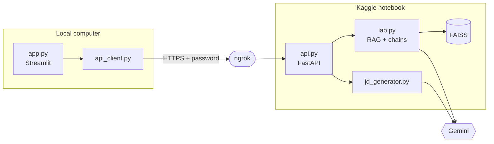

# AI Interview Simulator

A practice tool for job interviews. Given a CV, it suggests a suitable role, writes a job description, asks tailored interview questions, and scores each answer with feedback on what was missing and how to improve it.

The interface is a Streamlit app that runs locally. The AI logic runs as a FastAPI service in a Kaggle notebook, uses Google Gemini, and is reached through an ngrok tunnel.

## Features

- Upload a PDF CV or paste its text
- Role and job description suggested from the CV, or generated from a role title
- Technical and behavioral questions based on the CV and the job description
- Score from 0 to 10 for each answer, with missing points and concrete suggestions
- Final report with the average score and the strongest answers

## Architecture



## How it works

Each model call is a LangChain chain: a prompt template, Gemini, and a Pydantic schema that forces the answer into named fields. Failed calls are retried up to three times.

Question generation and answer evaluation also use retrieval (RAG). The job description and a file of sample questions are split into chunks, embedded with Gemini, and stored in a FAISS index. Before each call, the three most relevant chunks are retrieved and added to the prompt.

| Step | Endpoint | Chain | RAG |
|---|---|---|---|
| Role and job description from a CV | `/suggest-role` | Yes | No |
| Job description from a role | `/job-description` | Yes | No |
| Generate questions | `/questions` | Yes | Yes |
| Evaluate an answer | `/evaluate` | Yes | Yes |

All endpoints except `/health` require an `Authorization: Bearer <API_PASSWORD>` header.

## Tech stack

Streamlit, FastAPI, LangChain, Pydantic, FAISS, Google Gemini (chat and embeddings), ngrok, Kaggle.

## Project structure

```
app.py              Streamlit interface (local)
api_client.py       HTTP client for the backend (local)
pdf_utils.py        PDF text extraction (local)
data/               Demo CV and job description
kaggle_backend/     lab.py, jd_generator.py, api.py and sample questions
requirements.txt
```

## Getting started

**Backend (Kaggle).** Create a notebook with Internet enabled and add these secrets: `GOOGLE_API_KEY`, `NGROK_TOKEN`, and `API_PASSWORD` (any password you choose). Run the cells that install the packages, write the files in `kaggle_backend/`, and start the server. The last cell prints a public URL.

**Frontend (local).**

```bash
git clone https://github.com/reemtest/AI-Interview-Simulator.git
cd AI-Interview-Simulator
pip install -r requirements.txt
streamlit run app.py
```

Paste the public URL and the password into the sidebar, load a CV, and start the interview. The free ngrok URL changes whenever the server restarts, so update it in the sidebar each time.


## Future work

A larger question bank with model answers, follow-up questions based on earlier answers, voice input, saved interview history, and permanent hosting for the backend.